# Hi, I'm Hazenix 👋

  

          

- Backend Engineer focused on Java & Cloud Native. Exploring system architecture, Agent Harness and Agent Infra.

- Studying **Software Engineering** at Central South University(2024-2028)
  - Minister of Network Technology, Zhixin Hall, Central South University (2025–2026)
- Personal Website：https://blog.hazenix.top

---

## Work Experience

**Xiaohongshu** · International Search & Agents\
*Backend Engineering Intern*

**ByteDance** · ByteCloud Agent Infrastructure\
*Backend Engineering Intern*

**Gapasea** · Marketing Platform\
*Full-Stack Engineering Intern*

---

## Currently contributing to

<strong>29 merged PRs across 8 open source projects.</strong>

<table>
  <tr>
    <td width="50%" valign="top">
      <strong><a href="https://github.com/milind-soni/OpenMausBot">OpenMausBot</a></strong>&nbsp;
      
        
      Added conversation forks and a <code>/fork</code> command, configurable OpenRouter models for memory upkeep, bot usage reporting, and support for larger Vault secrets. Improved Bot Library file lookups, message history, automation sync, Linux updates, and workspace export recovery.
        
      <a href="https://github.com/milind-soni/OpenMausBot/pulls?q=is%3Apr+author%3AHazenix+is%3Amerged">View 11 merged PRs →</a>
    </td>
    <td width="50%" valign="top">
      <strong><a href="https://github.com/opensandbox-group/OpenSandbox">OpenSandbox</a></strong>&nbsp;
      
        
      Sped up pooled Pod event handling and sandbox file searches, kept the scheduler from contacting terminating Pods, and bounded Python SDK health probe waits. Added OTLP/gRPC metrics export and Ingress connection pool tuning.
        
      <a href="https://github.com/opensandbox-group/OpenSandbox/pulls?q=is%3Apr+author%3AHazenix+is%3Amerged">View 7 merged PRs →</a>
    </td>
  </tr>
  <tr>
    <td width="50%" valign="top">
      <strong><a href="https://github.com/bytedance/deer-flow">deer-flow</a></strong>&nbsp;
      
        
      Added file attachments to queued Web messages and fixed prompt editing and reruns after long runs. Reduced message history serialization in <code>chat()</code>, retried truncated summaries, and preserved Jina Reader HTTP error codes.
        
      <a href="https://github.com/bytedance/deer-flow/pulls?q=is%3Apr+author%3AHazenix+is%3Amerged">View 5 merged PRs →</a>
    </td>
    <td width="50%" valign="top">
      <strong><a href="https://github.com/NevaMind-AI/memU">memU</a></strong>&nbsp;
      
        
      Sped up URL matching for batch resource commits and fixed cleanup of query extraction process trees on macOS, Linux, and Windows.
        
      <a href="https://github.com/NevaMind-AI/memU/pulls?q=is%3Apr+author%3AHazenix+is%3Amerged">View 2 merged PRs →</a>
    </td>
  </tr>
  <tr>
    <td width="50%" valign="top">
      <strong><a href="https://github.com/apache/dubbo-go">Apache Dubbo-go</a></strong>&nbsp;
      
        
      Reused the Triple protocol's MsgPack codec handle so encoding and decoding can share its type cache across calls.
        
      <a href="https://github.com/apache/dubbo-go/pull/3842">View PR #3842 →</a>
    </td>
    <td width="50%" valign="top">
      <strong><a href="https://github.com/humanfia/humanize">humanize</a></strong>&nbsp;
      
        
      Improved agent configuration diagnostics by distinguishing unknown CLIs from missing models, with actionable errors, matching documentation, and regression coverage.
        
      <a href="https://github.com/humanfia/humanize/pull/550">View PR #550 →</a>
    </td>
  </tr>
  <tr>
    <td width="50%" valign="top">
      <strong><a href="https://github.com/wechatsync/Wechatsync">Wechatsync</a></strong>&nbsp;
      
        
      Added Markdown draft sync for Alibaba Cloud Developer Community, including image uploads and a link to edit the new draft.
        
      <a href="https://github.com/wechatsync/Wechatsync/pull/238">View PR #238 →</a>
    </td>
    <td width="50%" valign="top">
      <strong><a href="https://github.com/barkure/CSU-Net-Portal">CSU-Net-Portal</a></strong>&nbsp;
      
        
      Clarified campus network login results, fixed URL encoding for credentials in Shell and OpenWrt, and added log rotation for Node.js.
        
      <a href="https://github.com/barkure/CSU-Net-Portal/pull/12">View PR #12 →</a>
    </td>
  </tr>
</table>

---

## GitHub Activity

<picture>
  <source media="(prefers-color-scheme: dark)" srcset="assets/github-activity-dark.svg">
  <source media="(prefers-color-scheme: light)" srcset="assets/github-activity-light.svg">
  
</picture>

---

## Let's Connect

  
  
  

   
   

  **Thanks for visiting! Feel free to explore my repositories and don't forget to ⭐ projects you find interesting!**

  

